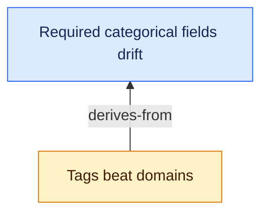

# Verbs: query

Read this for `show`, `log`, `list`, `near`, `trace`, `impact` and `graph`, and
for capped lists.

Contents:

- [Query](#query)
  - [Capped lists](#capped-lists)

## Query

| verb | does | flags |
|---|---|---|
| `neb show <NODE>` | one node in full, plus its body, currently or at a historical revision | `--at <HASH\|YYYY-MM-DD>` |
| `neb log <NODE>` | commits that changed the node, newest first | — |
| `neb list` | every node | `--status <S>`, `--tag <TAG>`× (every tag must match), `--limit <N>` |
| `neb near <QUERY>...` | the existing nodes closest to free text, or to a node (left out of its own answer), best first, each banded `strong`/`some`/`weak`; for a node, marks neighbours already linked to it | `--limit <K>`/`-k` (default 3); flags may follow the query |
| `neb trace <NODE>` | ancestry as a tree on a terminal (one tab-separated line per node when piped), each line naming its edge kind(s) | `--down` for descendants, `--depth <N>` |
| `neb impact <NODE>` | descendants plus `contradicts` neighbours | — |
| `neb graph` | the whole corpus as `{nodes, edges}` or a Mermaid diagram | `--json`, or `--mermaid [--from <ID>]`; without a format, a `usage` refusal naming both, exit 2 |

```json
// neb show tags-beat-domains --json
{
  "node": {
    "id": "tags-beat-domains",
    "title": "Tags beat domains",
    "title_by": "human",
    "status": "hypothesis",
    "created": "2026-09-12",
    "updated": "2026-09-12",
    "kill": "a corpus of 50+ nodes needs a cross-cutting query that tags cannot answer",
    "kill_by": "human",
    "tags": ["design", "corpus"],
    "edges": [
      { "type": "derives-from", "to": "required-categorical-fields-drift", "by": "human" },
      { "type": "contradicts", "to": "a-single-global-taxonomy", "by": "human" }
    ],
    "references": [
      { "id": "r1", "kind": "article", "uri": "https://example.org/folksonomy",
        "title": "Folksonomies", "note": "the drift argument, made for web tagging",
        "added": "2026-09-12", "by": "human", "origin": null }
    ],
    "closed": null,
    "origin": null
  },
  "body": "tags beat domains because a category you must pick is a decision you skip",
  "notes": [],
  "observatory": [],
  "handed_off_to": null
}
```

In text, `show` opens with a header: the status and id; the title, followed
by `(<label>)` when an agent wrote it; `tags: a, b` when there are any; and
`created: <date>  updated: <date>`. The kill condition, each edge and each
reference likewise end in `(<label>)` when their author is not `human`.

```
// neb show tags-beat-domains
hypothesis tags-beat-domains
Tags beat domains
tags: design, corpus
created: 2026-09-12  updated: 2026-09-12

kill: a corpus of 50+ nodes needs a cross-cutting query that tags cannot answer

…the body, then the edges and references
```

`neb show <NODE> --at <HASH|YYYY-MM-DD>` has exactly the same text and JSON
shape as current `show`; a date means the newest commit whose own day is on or
before that date as `neb log` dates it, using the offset it was recorded with.
The reader's timezone never changes which revision a date names. A date before
the node existed is refused. `neb log <NODE>` is a table of short hash, date and
message.

When no commit has touched the node, text output says `no commits touched this
node`; its JSON stays `[]`. Otherwise its JSON keeps the full hash:

```json
// neb log tags-beat-domains --json
[
  { "hash": "be82c52c9420bbd5bf50b284ad07a050575524f1", "date": "2026-09-21",
    "message": "neb sharpen tags-beat-domains" },
  { "hash": "9cfa9bf3e11b0ad32899d84bf1049511f060f19a", "date": "2026-09-20",
    "message": "neb new tags-beat-domains" }
]
```

Both historical verbs require the corpus to be inside a git work tree and are
read-only. With no repository at or above the root they refuse as
`not_git_work_tree`; a repository git cannot read is `git` instead. For
`show --at`, a hash that names no commit is `unknown_revision`, and a commit
from before the node existed is `no_node_at_revision`.

`neb list --json` is an array of the same `node` objects (no `body`), every
field present. A closed node carries
`"closed": { "why": "...", "at": "2026-09-12" }`; an open one `"closed": null`,
and likewise `null` for no `kill` or `origin` and `[]` for no tags, edges or
references.

### Capped lists

`--limit <N>` on `list`, `inbox` and `review` (per section; lines with
`--short`) and `--depth <N>` on `trace` bound the output; without them
everything is printed, as before.

N is at least 1, as is `near`'s `-k`, and `review --since` is at least 0: a
value below is a usage error (exit 2, stdout empty) rather than an empty answer
that reads as a real one. stdout holds the records alone, and stderr says what
was left out (`2 of 3 matching nodes shown, of 4 in all; raise --limit for
more`), in text mode and under `--json` alike.

Uncut, text mode's stderr carries the count instead (`3 of 4 nodes`). A filter
that matches nothing leaves stdout empty (`[]` under `--json`) and says `no
nodes match` on stderr.

Under `--json`, the flag changes the shape: with it, the list is an envelope
whether or not anything was cut, and without it the list is the bare array.

```json
// neb list --tag design --limit 1 --json
{ "items": [ { "id": "a-single-global-taxonomy", … } ], "total": 3, "truncated": true }
```

`items` is what was kept, `total` how many matched before the cut, and
`truncated` whether the cut dropped any. For `review`, `total` counts the
findings of every rule before each kept its first N; for `trace --depth`, it
is how many nodes the whole walk reaches. `near` always has a limit (`-k`,
default 3), so its `--json` is always the envelope, and a cut also says
`K of N shown; raise -k for more` on stderr, in text mode too.

`near` is word overlap — BM25 over title, tags and body, title and tags
weighted up, plurals and `-ing` folded, no embeddings and no network — with
the score normalised so `1` would saturate every word of the query. Nothing
does: a word-for-word copy of a node scores about `0.35`–`0.6` against it,
so the number is not a percentage and text output does not print it. It
prints a band instead, and `--json` carries both `score` and `band`:

| band | score | reads as |
|---|---|---|
| `strong` | `0.25` and up | shares most of the query's distinctive words: a possible duplicate, or the obvious parent |
| `some` | `0.07` to `0.25` | shares a few distinctive words: read it before deciding |
| `weak` | under `0.07` | a word or two in passing |

The cut-offs come from a synthetic corpus of sixteen varied nodes: copies and
promoted copies scored `0.44`–`0.59` (one in a real corpus scored `0.36`),
sentences reusing most of a node's key words `0.28`–`0.53`, a sentence sharing
one incidental word `0.09`–`0.20`, and a whole node against the others
`0.07`–`0.13` for its topical neighbours and under `0.07` for nearly everything
else.

A short query scores higher for the same overlap (one word is half of a two-word
query), so a one-word match on a two-word query can read `strong`. The band
never reorders anything; the order is the score's.

Given a node, each neighbour's `linked` lists the edges already joining it
to that node, either way round, as `{from, type, to}` in declaration order;
text's `LINKED` column says `parent (<kinds>)`, `child (<kinds>)` or
`contradicts`. It is `null` (`-` in text) when there is no such edge, and
always for free text. The `near:` block `capture` and `promote` print is not
a table: one line per neighbour, band first. A linked
neighbour is a link that exists, not one to make.

Nodes sharing no word are left out, so an empty answer (`"items": []` with
`"total": 0`, or nothing in text, with `nothing near: no node shares a word
with this` on stderr in both) is a real finding: the
thought is unlike anything in the corpus. It ranks candidates for a human to
read; it never writes anything, and passing its top candidate straight to
`--parent` unread is the automatic linking the spec rules out.

```json
// neb near --json "one global taxonomy for every domain"
{
  "items": [
    { "id": "a-single-global-taxonomy", "title": "A single global taxonomy",
      "status": "abandoned", "tags": ["design"], "score": 0.301, "band": "strong", "linked": null },
    { "id": "tags-beat-domains", "title": "Tags beat domains",
      "status": "hypothesis", "tags": ["design", "corpus"], "score": 0.138, "band": "some", "linked": null }
  ],
  "total": 2,
  "truncated": false
}

// neb near tags-beat-domains        (on a terminal; the node's own text is the query, and it is not in the answer)
BAND    STATUS     ID                                 TITLE                              LINKED
strong  abandoned  a-single-global-taxonomy           A single global taxonomy           contradicts
some    seed       required-categorical-fields-drift  Required categorical fields drift  parent (derives-from)
```

`neb trace` prints a tree on a terminal, drawn from the same walk `--json`
returns. Every line below the start names the genealogy edge kind(s) of the step
that first reached it. The kinds are always the descendant's edges, so they read
the same both ways: walking up, the line above declares them to this one;
walking down, this one declares them to the line above.

Two edges between the same pair (`derives-from` plus a later `reopens`) are one
relation stated twice, so they draw as one line naming both kinds. A node joined
to more than one node on the walk is a true diamond: it is drawn out once, under
the step that first reached it, and each other place it joins points to it with
`(shown above)` (or `(shown below)`), naming no kinds.

A node handed off to Observatory ends its line with `handed off to <RECORD>`.

```
// neb trace retardation-in-the-wake        (on a terminal)
hypothesis retardation-in-the-wake Retardation in the wake
├─ derives-from, reopens  refuted    scarcity-wake-retardation Scarcity wake retardation
│  └─ derives-from  seed       gravity-as-scarcity Gravity as scarcity
└─ seed       gravity-as-scarcity Gravity as scarcity  (shown above)
```

Piped or redirected, it prints one tab-separated line per node instead, in
walk order: the steps from the start along the first path to it, the id, the
status, the title, and the kinds of the step that reached it joined by `,`
(`-` for the start). No glyphs, no pointers, so `cut -f2` is the ids:

```
// neb trace retardation-in-the-wake | cat
0	retardation-in-the-wake	hypothesis	Retardation in the wake	-
1	scarcity-wake-retardation	refuted	Scarcity wake retardation	derives-from,reopens
2	gravity-as-scarcity	seed	Gravity as scarcity	derives-from
```

`--depth <N>` stops the walk N steps out (`1`, the least, is the parents, or
the children with `--down`), in the tree, the lines and `--json` alike.
When it left nodes out, stderr says how many, in every mode (`2 more nodes
beyond --depth 1; raise --depth for more`). A node within N steps along any
path is kept, even when the first path the walk took reached it further out.
Without `--depth` the whole walk is printed, as before.

`--json` lists each node once, in walk order. `parents` names each genealogical
parent once, however many edges reach it. `via` is the step that first reached
the node: `from` is the node it was reached from, and `kinds` lists every edge
kind between the two, in declared order. It is `null` for the start.
`handed_off_to` names the Observatory record a node was handed off to, and is
`null` for every other node. With `--depth` the list is the
[capped-list](#capped-lists) envelope.

```json
// neb trace tags-beat-domains --json
[
  { "id": "tags-beat-domains", "title": "Tags beat domains", "status": "hypothesis",
    "parents": ["required-categorical-fields-drift"], "via": null, "handed_off_to": null },
  { "id": "required-categorical-fields-drift", "title": "Required categorical fields drift",
    "status": "seed", "parents": [],
    "via": { "from": "tags-beat-domains", "kinds": ["derives-from"] }, "handed_off_to": null }
]

// neb impact required-categorical-fields-drift --json     (via: descends | contradicts)
[ { "id": "tags-beat-domains", "via": "descends" } ]

// neb graph --json
{
  "nodes": [
    { "id": "tags-beat-domains", "title": "Tags beat domains", "status": "hypothesis",
      "tags": ["design", "corpus"], "created": "2026-09-12", "updated": "2026-09-12" }
  ],
  "edges": [
    { "from": "tags-beat-domains", "type": "derives-from", "to": "required-categorical-fields-drift" },
    { "from": "tags-beat-domains", "type": "contradicts", "to": "a-single-global-taxonomy" },
    { "from": "a-single-global-taxonomy", "type": "contradicts", "to": "tags-beat-domains" }
  ]
}
```

`neb graph --mermaid` emits a `graph BT` block with every node styled by status
and every edge labelled by kind. Symmetric `contradicts` edges become one
dotted, undirected line. Add `--from <ID>` to include only that node, its
ancestors and its descendants; siblings and unrelated components stay out.

`--from` requires `--mermaid`, and both conflict with `--json` whether it is
written before the verb or after it (exit 2), so JSON always exports the whole
corpus rather than silently ignoring a requested lineage. Titles are escaped so
quotes and brackets remain label text.


